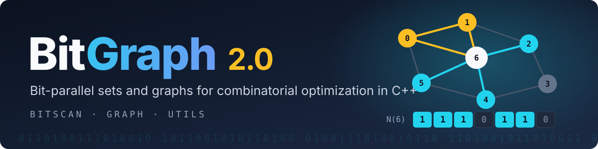

<p align="center">
  
</p>

<p align="center">
  <a href="LICENSE"></a>
  
  
  
  <a href="CHANGELOG.md"></a>
</p>

**BitGraph** is a C++ library for fast set and graph operations, built on one idea: a set of integers is a string of bits, and a graph is a table of such sets. Intersecting two neighbourhoods, testing whether two sets overlap, or counting a candidate set each become a handful of machine-word operations.

It consists of two main libraries, **BITSCAN** (bitsets with very fast bit scanning) and **GRAPH** (graphs stored as bitsets), plus a small supporting library, **UTILS**. They come from more than 20 years of research in combinatorial optimization and sit at the core of many exact algorithms for hard problems such as maximum clique, graph colouring and constraint satisfaction (see [Used in](#used-in)).

**Website:** [psanse.github.io/BitGraph](https://psanse.github.io/BitGraph/)

## Contents

- [Why BitGraph](#why-bitgraph)
- [Quick start](#quick-start)
- [Installation](#installation)
- [Repository layout](#repository-layout)
- [Documentation](#documentation)
- [Performance](#performance)
- [Platforms and releases](#platforms-and-releases)
- [License](#license)
- [Citation](#citation)
- [Used in](#used-in)
- [Acknowledgements](#acknowledgements)

## Why BitGraph

**A graph is a table of bitsets.** In GRAPH, row *v* of the adjacency matrix is a bitset holding the neighbours of *v*. Common neighbours, induced subgraphs and candidate filtering reduce to bitwise `AND`, `OR` and `AND NOT` over rows, which touch 64 vertices per machine word.

- **One idiom from set to graph.** The bitset operations used to write algorithms (`&=`, `count()`, `intersects()`, scanning) are the same ones the graph exposes for its adjacency rows, so no translation layer sits between the algorithm and the data.
- **Scanning that stays out of the way.** BITSCAN enumerates set bits forward or in reverse, destructively or not, through small scanner objects (`bitarray::scan`, `scanR`, `scanD`, `scanDR`) or through independent views that each carry their own cursor.
- **Efficient where it matters.** Bulk operations (`&=`, `count()`) cost the same as `std::bitset`, and scanning is the strong point: on dense sets the forward scan is about 2 times faster than libstdc++'s `_Find_next` and `boost::dynamic_bitset::find_next` (10% to 50% occupancy), and 3 to 57 times faster than the portable `test(i)` loop. The reverse scan is 3.6 to 62 times faster than the only portable alternative, and the sparse types are up to 50 to 80 times faster than `std::bitset` on `&=` and `count()` when few blocks are populated. The scan-while-modifying loop of bit-parallel algorithms runs at parity with `boost::dynamic_bitset`. Measured numbers are in [Performance](#performance).
- **Dense and sparse, same API.** `bitarray` and `ugraph` store every 64-bit block and suit dense or moderate-size problems. `sparse_bitarray` and `sparse_ugraph` store only the non-empty blocks, so very large graphs with few edges stay small.
- **Weighted graphs and real file formats.** Vertex- and edge-weighted undirected graphs (`ugraph_vw`, `ugraph_ew`), and readers and writers for DIMACS, Matrix Market and edge-list files, with automatic format detection when reading.
- **Orderings and generators.** Degree and degeneracy orderings (`GraphSort`), reversible vertex relabelling, and generators for classic graphs and uniform random graphs.
- **Portable.** C++14, no external dependencies besides the standard library (GoogleTest is fetched only to build the tests). Tested with GCC and MSVC on Linux and Windows. See [docs/benchmarks.md](docs/benchmarks.md) for measured performance.

## Quick start

Common neighbours of two vertices, then a scan of the result:

```cpp
#include <iostream>
#include "BitGraph/graph/graph.h"

int main() {
    using namespace bitgraph;

    ugraph g(6);                              // undirected graph, 6 vertices
    g.add_edge(0, 1);  g.add_edge(0, 2);  g.add_edge(0, 3);
    g.add_edge(1, 2);  g.add_edge(1, 3);  g.add_edge(3, 4);

    // Adjacency rows are bitsets: the common neighbours of 0 and 1 take one AND
    bitarray common = g.neighbors(0);
    common &= g.neighbors(1);

    // Enumerate the set bits
    bitarray::scan scan(common);
    for (int v = scan.next_bit(); v != BBObject::noBit; v = scan.next_bit()) {
        std::cout << v << ' ';                // prints: 2 3
    }
    std::cout << '\n';
}
```

A massive, mostly empty set with the sparse bitset:

```cpp
#include <iostream>
#include "BitGraph/bitscan/bitscan.h"

int main() {
    using namespace bitgraph;

    sparse_bitarray big(10000000);            // 10M elements, few of them set
    big.set_bit(0);
    big.set_bit(900000);
    big.set_bit(9999999);

    sparse_bitarray::scan scan(big);          // forward scan; scanR, scanD, scanDR also exist
    for (int bit = scan.next_bit(); bit != BBObject::noBit; bit = scan.next_bit()) {
        std::cout << bit << ' ';              // prints: 0 900000 9999999
    }
    std::cout << '\n';
}
```

More runnable programs are in the `examples/` folder of each library: [BITSCAN](src/bitscan/examples), [GRAPH](src/graph/examples) and [UTILS](src/utils/examples).

Other projects built on BitGraph 2.0 are listed in [Built with BitGraph](https://psanse.github.io/BitGraph/#examples) on the website.

## Installation

```
git clone https://github.com/psanse/BitGraph.git
cd BitGraph
cmake -S . -B build -DCMAKE_BUILD_TYPE=Release
cmake --build build
cmake --install build            # installs into ./install by default (override with CMAKE_INSTALL_PREFIX)
```

Use the installed library from another CMake project:

```cmake
find_package(BitGraph CONFIG REQUIRED)
target_link_libraries(my_app PRIVATE BitGraph::graph BitGraph::bitscan BitGraph::utils)
```

CMake 3.14 or newer and a C++14 compiler are required. Tests and examples are built by default when BitGraph is the top-level project. More options, including `FetchContent`, are described in [src/README.md](src/README.md), and a complete consumer project is in [install/](install).

## Repository layout

```
BitGraph/
├── src/
│   ├── bitscan/     BITSCAN: bitsets and bit scanning       (README, examples/, tests/, benchmarks/)
│   ├── graph/       GRAPH: graphs, formats, orderings        (README, examples/, tests/)
│   ├── utils/       UTILS: logger, timers, random, helpers   (README, examples/, tests/)
│   └── cmake/       CMake package configuration
├── install/         a stand-alone CMake project that consumes an installed BitGraph
├── docs/            guides, API overview, benchmarks
├── CHANGELOG.md     release notes and the 1.x to 2.0 migration table
├── CITATION.cff     how to cite BitGraph
└── LICENSE          GNU GPL v3
```

## Documentation

| Library | Guide | API overview | Examples |
|---|---|---|---|
| BITSCAN | [src/bitscan/README.md](src/bitscan/README.md) | [docs/api/bitscan.md](docs/api/bitscan.md) | [examples](src/bitscan/examples) |
| GRAPH | [src/graph/README.md](src/graph/README.md) | [docs/api/graph.md](docs/api/graph.md) | [examples](src/graph/examples) |
| UTILS | [src/utils/README.md](src/utils/README.md) | [docs/api/utils.md](docs/api/utils.md) | [examples](src/utils/examples) |

- [CHANGELOG.md](CHANGELOG.md): what changed in 2.0, with a migration table from 1.x.
- [docs/benchmarks.md](docs/benchmarks.md): measured performance against `std::bitset`.
- The headers carry Doxygen comments. A full HTML reference can be generated locally, see [docs/README.md](docs/README.md).

## Performance

BITSCAN and GRAPH are different cases. BITSCAN has direct counterparts (`std::bitset`, `boost::dynamic_bitset`), so it is benchmarked against them. GRAPH has none. Full tables, method and caveats are in [docs/benchmarks.md](docs/benchmarks.md).

### BITSCAN

Measured on a Xeon Gold 6342 with GCC 13 (`-O3`), on 100,000-bit sets, and on Windows with MSVC.

- **Sparse bitsets** are the clear win when few blocks are populated. At 1% occupancy, `&=` is about 50 times faster than `std::bitset`, `count()` about 80 times, and scanning 2.7 to 5 times faster than libstdc++'s own `_Find_next`.
- **Dense bitsets** match `std::bitset` on bulk operations (`&=`, `count()`) and are not faster than it. Their value is a sizes-at-run-time API with scans that the standard library lacks: the reverse scan is 3.6 to 62 times faster than the only portable alternative, and the forward scan is 3 to 57 times faster than a `test(i)` loop and about 2 times faster than libstdc++'s non-portable `_Find_next` and `boost::dynamic_bitset::find_next` on dense content (10% to 50% occupancy; about 1.2 times slower at 1%).
- **Scan while modifying a set**, the core loop of bit-parallel graph algorithms, runs at parity with `boost::dynamic_bitset` (the runtime-sized alternative) and is 1.15 to 1.7 times slower than `std::bitset<N>` when `N` is a compile-time constant. There is measurable headroom in the library's dense paths.
- **Where the standard library has no find-next (MSVC)**, BitGraph scans 2.7 to 42 times faster than the portable `std::bitset` loop, and its colouring loop is 1.1 to 14 times faster, growing with size and density.
- **Trade-off:** random access on sparse bitsets is slower than on dense ones (about 5 times slower at 1% occupancy), so choose the sparse types for large, mostly empty sets.

### GRAPH

There is no counterpart to compare GRAPH with: no standard library, and no widely used library, offers graphs stored as bitset adjacency matrices with these operations. For that reason GRAPH is **not benchmarked against another library**, and no speedup is claimed for it.

What can be said is how its performance arises. Row *v* of the adjacency matrix is a BITSCAN bitset, so graph operations such as common neighbours, induced subgraphs and candidate filtering are the BITSCAN operations measured above. The colouring benchmark in the BITSCAN part is exactly such a graph algorithm, written on bitset rows. The dense and sparse trade-off carries over: `ugraph` uses dense rows, and `sparse_ugraph` uses sparse rows, which makes very large graphs possible (a dense adjacency matrix for 1,000,000 vertices would need 125 GB).

## Platforms and releases

| Toolchain | Status |
|---|---|
| GCC 13.3, Ubuntu 24.04 | build, tests, examples and installed-package check pass |
| MSVC 19.5 (Visual Studio 2026), Windows | build, tests, examples and installed-package check pass |

The latest release is **v2.0.0** (October 2026). Version 2.0 is a major refactoring and is **not source-compatible with 1.x**: see [CHANGELOG.md](CHANGELOG.md) for the changes and a migration table. The 1.x series (last release v1.4.3) is frozen.

## License

BitGraph is free software, released under the [GNU General Public License v3.0](LICENSE). Under the GPL, a program that you distribute and that links BitGraph is generally expected to be released under the GPL as well; this is a summary, not legal advice. Contact the author if you need different terms. Third-party code that BitGraph adapts or uses is listed in [THIRD_PARTY_NOTICES.md](THIRD_PARTY_NOTICES.md).

## Citation

If BitGraph helps your research, please cite it. GitHub's "Cite this repository" button reads [CITATION.cff](CITATION.cff). Please also cite the paper(s) behind the algorithms you use among those listed below. BITSCAN originated in the bit-parallel maximum clique work described in the 2011 paper in the list.

## Used in

The BITSCAN and GRAPH libraries are at the core of many exact algorithms, among them:

*   [CliReg: Clique-based robust Point Cloud Registration, 2025](https://ieeexplore.ieee.org/abstract/document/10892261).

*   [CliSAT: A new exact algorithm for hard maximum clique problems, 2023](https://www.sciencedirect.com/science/article/pii/S0377221722008165).

*   [A new branch-and-filter exact algorithm for binary constraint satisfaction problems, 2022](https://www.sciencedirect.com/science/article/pii/S0377221722008165).

*   [A new combinatorial branch-and-bound algorithm for the Knapsack Problem with Conflicts, 2021](https://www.sciencedirect.com/science/article/pii/S0377221720306342).

*   [A branch-and-cut algorithm for the Edge Interdiction Clique Problem, 2021](https://www.sciencedirect.com/science/article/pii/S0377221721000606).

*   [The maximum clique interdiction problem, 2019](https://www.sciencedirect.com/science/article/pii/S0377221719301572).

*   [A new branch-and-bound algorithm for the maximum edge-weighted clique problem, 2019](https://www.sciencedirect.com/science/article/pii/S0377221719303054).

*   [A new branch-and-bound algorithm for the Maximum Weighted Clique Problem, 2019](https://www.sciencedirect.com/science/article/pii/S0305054819301303).

*   [Efficiently enumerating all maximal cliques with bit-parallelism, 2018](https://www.sciencedirect.com/science/article/pii/S0305054817302988).

*   [A new exact maximum clique algorithm for large and massive sparse graphs, 2016](https://www.sciencedirect.com/science/article/pii/S0305054815001884).

*   [A novel clique formulation for the visual feature matching problem, 2015](https://link.springer.com/article/10.1007/s10489-015-0646-1).

*   [A new DSATUR-based algorithm for exact vertex coloring, 2012](https://www.sciencedirect.com/science/article/pii/S0305054811002966).

*   [An exact bit-parallel algorithm for the maximum clique problem, 2011](https://www.sciencedirect.com/science/article/pii/S0305054810001504).

and many others.

## Acknowledgements

This research has been partially funded by the Spanish Ministry of Economy and Competitiveness (MINECO) through national grants DPI2010-21247-C02-01, DPI2014-53525-C3-1-R, and DPI2017-86915-C3-3-R, and is currently supported by the Spanish Ministry of Science, Innovation and Universities (MICIU) through grant PID2024-155948OB-C54.

Thanks to the people who contributed to the code:

- **[Fabio Furini](https://fabiofurini.github.io/)**, with special thanks for his research collaboration and support.
- **Dan Stahlke**, for fixes found by enabling compiler warnings (including an out-of-bounds vector access), documentation corrections, and format-string checking in the logger.
- **Cristobal Tapia**, for contributions to the BITSCAN unit tests.

AI-assisted development tools, including Claude, were used for code review, documentation, test development, and refactoring support.
